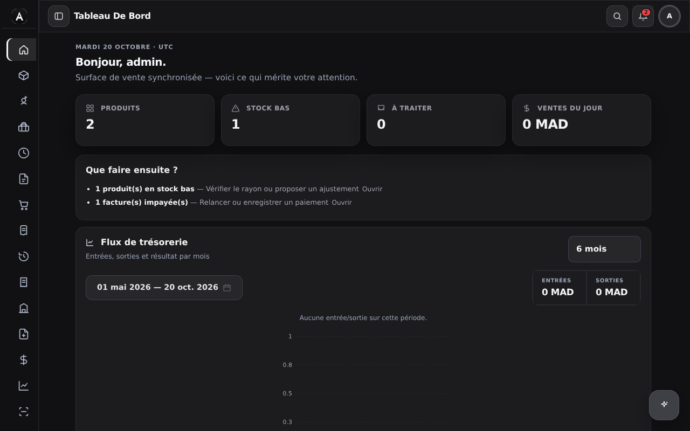
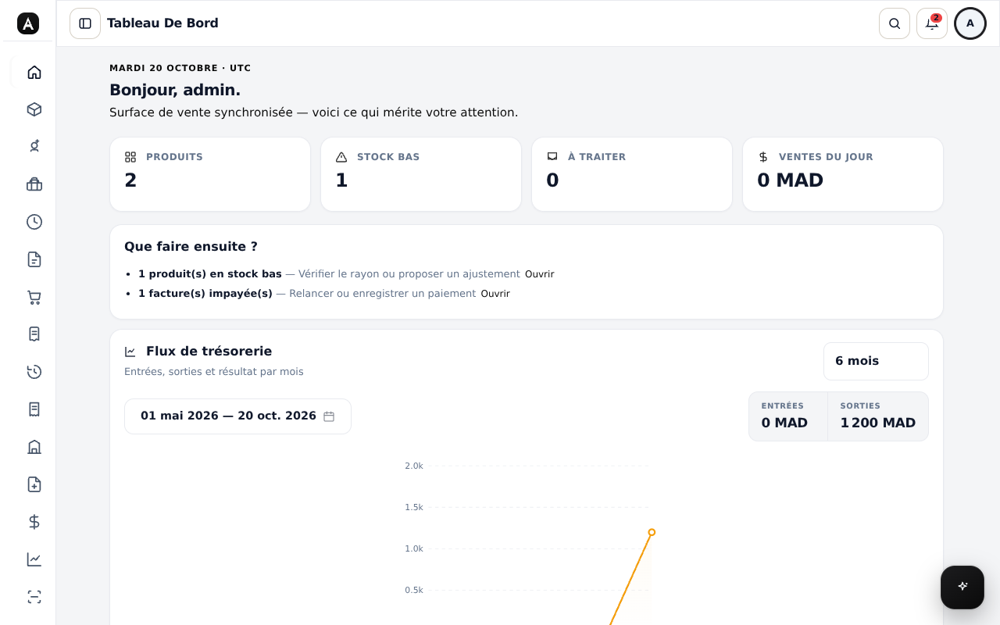
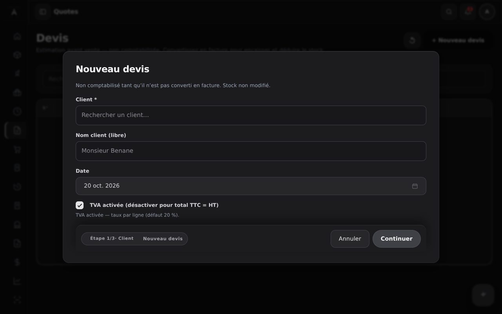
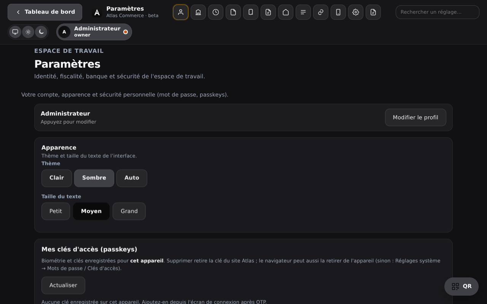
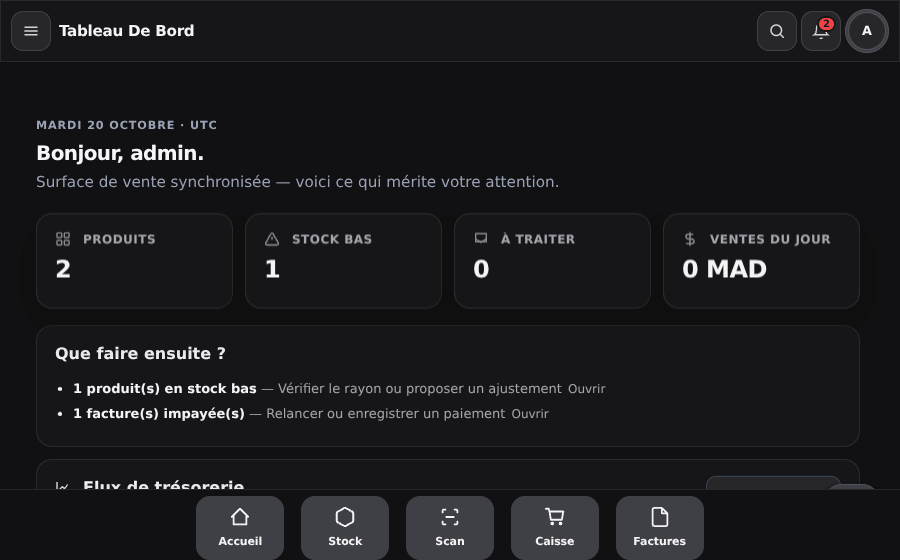

<div align="center">
  
  <h1>Atlas Commerce</h1>
  <p><strong>ERP / Caisse / Facturation souverain pour commerces &amp; grossistes au Maroc</strong><br/>Stock multi-dépôts · Caisse &amp; tickets VR · Facturation TVA &amp; créances · Scan &amp; OCR · Atlas Agent IA · WebAuthn &amp; login QR</p>

<!-- Badges -->


**Aperçu live (preview CF)** · **Ce README = documentation** · **[Signaler un bug](https://github.com/Etherealmber/atlas-commerce/issues/new)** · **[Demander une fonction](https://github.com/Etherealmber/atlas-commerce/issues/new)**

> Projet propriétaire : **loxdpy** — GitHub **[@loxdpsy](https://github.com/loxdpsy)** · Compte org : **Etherealmber**
</div>

---

## 📸 Captures d'écran réelles

Captures et enregistrement générés depuis l'application elle-même (Chromium headless, `scripts/capture-shots.mjs`).

| Tableau de bord — sombre | Tableau de bord — clair |
| --- | --- |
|  |  |

| Assistant devis (sombre) | Paramètres — apparence |
| --- | --- |
|  |  |

Enregistrement d'une session complète (connexion → tableau de bord → devis) :

Captures desktop **et téléphone** (coque mobile réelle) dans `public/shots/` ; posters Instagram 1:1 avec vrais écrans dans `marketing/atlas-instagram-posters.zip`.



## 🚀 Starter — démarrer de zéro

Guide pas à pas, aucune connaissance de Cloudflare requise.

### 0. Prérequis

- **Node.js ≥ 20** et `npm`
- Un compte **Cloudflare gratuit**
- Wrangler CLI : `npx wrangler login` (une fois)

### 1. Récupérer le code

```bash
# via GitHub CLI (recommandé) : fork + clone
gh repo fork Etherealmber/atlas-commerce --clone=true
cd atlas-commerce
# ou sans gh : forkez sur github.com puis
# git clone https://github.com/VOTRE_COMPTE/atlas-commerce.git && cd atlas-commerce
npm install
```

### 2. Secrets locaux

```bash
printf 'ADMIN_USERNAME=admin\nADMIN_PASSWORD=ChangeMo123!\n' > .dev.vars
```

`.dev.vars` n'est **jamais commité** (gitignore). Choisissez un mot de passe fort.

### 3. Base locale D1

```bash
npx wrangler d1 execute DB --local --file=schema.sql   # schéma de base
npx wrangler d1 migrations apply DB --local            # migrations incrementales
```

### 4. Lancer

```bash
npm run dev -- --port 36521
```

Ouvrez **http://localhost:36521**, connectez-vous avec `admin` + votre mot de passe.
En local (sans binding e-mail) le premier appareil est approuvé automatiquement ;
en production l'**OTP par e-mail** protège chaque nouvel appareil.

Vérifiez l'API : `curl http://localhost:36521/api/health`.

### 5. Tests & captures (optionnel mais conseillé)

```bash
npm run smoke                              # suite de tests API bout-en-bout
LD_LIBRARY_PATH=... node scripts/capture-shots.mjs   # captures réelles (voir plus haut)
node scripts/make-posters.mjs              # 12 posters Instagram 1:1
```

### 6. Déployer sur Cloudflare

```bash
npx wrangler d1 create company-stock-db          # crée la D1 production
# → remplacez database_id dans wrangler.jsonc par l'id retourné
npx wrangler d1 execute DB --file=schema.sql     # schéma en production
npx wrangler d1 migrations apply DB              # migrations en production
npx wrangler r2 bucket create company-stock-images   # médias + updates Android
npx wrangler secret put ADMIN_PASSWORD           # secret production
npm run deploy                                   # deploy worker + assets
```

Bindings optionnels : `EMAIL` (SendMail/Workers Mail) pour l'OTP e-mail,
`TURNSTILE_SECRET` pour le challenge login. Sans `EMAIL`, les nouveaux
appareils distants ne pourront pas recevoir d'OTP — configurez-le en production.

### 7. App mobile (Android)

```bash
npm run cap:sync      # build web + sync Capacitor
npm run cap:open      # ouvre Android Studio
```

Les mises à jour OTA passent par le manifeste `latest.json` servi depuis R2
(Admin → Mise à jour app).

### 8. Besoin d'aide ?

- `STATUS_REVIEW.md`, `ARCHITECTURE_PARTNER_API_V1.md` : architecture & API
- Issues GitHub pour les bugs ; DM **@loxdpsy** pour les vulnérabilités
- Licence **MIT © 2026 loxdpsy** — forkez, modifiez, vendez vos services, citez-nous ★

## 🌟 À propos du projet

Atlas Commerce est un ERP/POS **auto-hébergé sur Cloudflare** (Workers + D1 + R2) pensé pour les commerces, grossistes et entrepôts au Maroc : gestion du stock multi-dépôts, caisse rapide (tickets VR sans TVA), facturation TVA avec créances et remboursements, achats/réceptions, devis, employés & paie, balance/trésorerie — **sans abonnement SaaS opaque** et sans dépendre d'un serveur dédié.

Le cœur est un **worker Cloudflare** (API REST + SSR) avec une base **D1** (SQLite managé), les médias et les mises à jour Android sur **R2** (`company-stock-images`), et un front **React + Vite** thémé (clair/sombre, densités, tailles de texte) décliné en coquille téléphone (Capacitor) et en app Android avec mises à jour OTA servies par le worker.

Points forts :

- **Scan & OCR** : un code-barres inconnu devient une demande de création produit (photo de facture/devis comprise), validée depuis la liste Produits.
- **Atlas Agent IA** : « crée un client nommé X avec email/téléphone » ouvre la fiche pré-remplie à vérifier ; confirmation explicite avant exécution.
- **Login moderne** : mot de passe + OTP, **WebAuthn/passkeys**, **login QR** PC↔téléphone (60 s, usage unique).
- **Thème sombre complet** : chaque composant (agent, menus, popups téléphone, datepickers) est thémé zinc clair/sombre.
- **Offline-first terrain** : coquille téléphone minimaliste, rôles (owner/admin/stock/terrain), actions mobile en attente.

## 🧭 Roadmap

La roadmap comparative est tenue dans la section **§Roadmap v209** plus bas : 10 chantiers S/M/L **déjà livrés** (ops scan-first, lots/FEFO, centre d'alertes, références fournisseur, pipeline statuts, étiquettes, kits/BOM, webhooks, emplacements bin). Les prochaines idées passent par les [issues](https://github.com/Etherealmber/atlas-commerce/issues).

## 🛠️ Intégration

Atlas Commerce est conçu pour être étendu :

- **API REST** `/api/*` (worker) — sessions JWT, rôles, idempotence sur les écritures.
- **Webhooks événementiels** `stock.receive`, `stock.count`, `stock.transfer`, `doc.*`, `kit.assembled`, `atlas.alert` (Settings → API).
- **Mises à jour Android** : `latest.json` / `latest.apk` servis depuis R2 via le worker (lien + APK dans Paramètres).
- **OCR & scan** : BarcodeDetector natif + OCR photos de factures/devis → données structurées.
- **Étiquettes imprimables** : `/api/products/:id/label.svg` (QR + CODE128 + prix).

## 👾 Tech Stack

<details open>
<summary>Serveur</summary>

- [Cloudflare Workers](https://workers.cloudflare.com/) (Hono) — API + SSR + cron
- [D1](https://developers.cloudflare.com/d1/) (SQLite managé) — schéma `schema.sql` + migrations
- [R2](https://developers.cloudflare.com/r2/) — médias, backups, updates Android
</details>

<details open>
<summary>Client</summary>

- [React](https://react.dev/) + [Vite](https://vitejs.dev/) + TypeScript
- [Capacitor](https://capacitorjs.com/) — app Android (OTA via R2)
- CSS maison thémé (`dark-force.css` chargé en dernier)
</details>

<details>
<summary>Sécurité</summary>

- JWT + OTP, **WebAuthn/passkeys**, login QR usage unique
- Cloudflare Turnstile, rate-limit + réputation IP
- Suppressions sans mot de passe (confirmations progressives), audit log
</details>

## 🧰 Déploiement / Démarrage

```bash
npm install
cp .env.example .dev.vars        # secrets locaux (jamais commités)
npm run dev -- --port 36521      # preview local (worker + vite)
npx wrangler d1 migrations apply DB --local
npm run build                    # build client + worker
npx wrangler preview             # preview Cloudflare (CI production = previews uniquement)
npm run deploy                   # déploiement production manuel depuis main
```

Le build Cloudflare (dashboard) exécute `npm run build` puis `npx wrangler preview` : **la production n'est mise à jour que par `npm run deploy` depuis `main`**.

## 📱 App mobile

Compagnon Android (Capacitor) : coquille terrain minimaliste (Accueil, Stock, Scan, Caisse, Factures, Agent), scan code-barres, réceptions/transferts/inventaire, notifications = centre d'alertes. Mises à jour via Paramètres → lien + APK (R2, servies par le worker).

## 🔒 Code de conduite & politique de sécurité

Merci de signaler toute vulnérabilité via une issue **privée** ou par message direct au propriétaire (**@loxdpsy**) — pas de divulgation publique avant correctif. Les secrets (`.dev.vars`, tokens) ne sont jamais commités ; les backups D1 sont chiffrés côté R2.

## 👋 Contribuer

Projet propriétaire (licence MIT © 2026 loxdpsy). Les contributions passent par **pull requests** depuis une branche `arena/*` ou `feature/*` : une PR = un lot cohérent, build vert (`npm run build`), `tsc --noEmit` sans nouvelle erreur, et description en français listant les zones touchées.

## 📜 Traduction

Interface **français** (terrain Maroc). Les libellés sont centralisés (`src/lib/labels.ts`) pour préparer une future traduction arabe/anglais.

## 💎 Remerciements

- Cloudflare, React, Vite, Hono, Capacitor et leurs communautés.

## ❤️ Support

Atlas Commerce est développé et maintenu par **loxdpy ([@loxdpsy](https://github.com/loxdpsy))** pour des commerces réels au Maroc (El Jadida). Usage interne & démonstrations : contactez le propriétaire via GitHub.

---

## 📚 Annexes opérationnelles

<details>
<summary><strong>Fonctionnalités (matrice)</strong></summary>

| Domaine | Couverture |
|---|---|
| Stock | multi-dépôts, emplacements bin, lots + expiration (FEFO), seuils, mouvements audités, inventaire tournant, transferts, kits/BOM |
| Caisse | tickets VR sans TVA, paiements multi-moyens, remboursements WR, solde caisse |
| Facturation | FA TVA, créances, échéances, avoirs, exports CSV, emails, pipeline statuts + journal |
| Achats | bills, réceptions, références fournisseur + paliers tarifaires |
| Tiers | clients (ICE, situation), fournisseurs, employés & paie |
| Scan/OCR | code-barres natif, demandes produit photo, OCR factures/devis |
| IA | Atlas Agent (création pré-remplie avec confirmation), permissions par action |
| Admin | utilisateurs & rôles, clés API + webhooks, backups D1→R2, audit, journal des versions |
</details>

<details>
<summary><strong>Scripts & secrets</strong></summary>

- `npm run dev` (port 36521), `npm run build`, `npm run deploy`, `npx wrangler preview`
- `.dev.vars` local : `ADMIN_USERNAME`, `ADMIN_PASSWORD`, `JWT_SECRET` — jamais commités
- R2 bucket `company-stock-images` : médias + `latest.json`/`latest.apk`
</details>

<details>
<summary><strong>Rôles & sécurité</strong></summary>

- Rôles : owner > admin > stock > terrain ; gating API par rôle
- Suppressions : confirmation progressive, **jamais de mot de passe** ; audit log
- Login : password+OTP, WebAuthn, QR 60 s usage unique ; Turnstile + rate-limit
</details>

<details>
<summary><strong>Conventions UI</strong></summary>

- Thème sombre zinc sur **tous** les composants (agent, menus, popups téléphone, datepickers, checkboxes)
- Wizards par étapes (Continuer au même niveau, pas de Retour à l'étape 1, Annuler bien placé)
- Erreurs **sous leur champ** uniquement ; scan n'exige jamais le prix
- Sidebar = topbar (même thème) ; téléphone = minimal, cibles ≥ 40 px, safe-area
</details>

<details>
<summary><strong>Roadmap v209 — livrée</strong></summary>

| # | Fonction | Adaptation Atlas | Statut |
|---|---|---|---|
| 1 | Stock locations | emplacements bin `products.location` + dépôts existants | ✅ |
| 2 | Batch/lot + expiry FEFO | `stock_lots` + alertes | ✅ |
| 3 | Scan-first receive/transfer/count | modes Scan + `/api/stock/receive|count` + `/api/inventory/transfer` | ✅ |
| 4 | Supplier parts + price breaks | `supplier_parts` + UI Vendors | ✅ |
| 5 | Status pipeline + journal | `/api/invoices/:id/pipeline` + `status_events` + chips | ✅ |
| 6 | Label printing | `/api/products/:id/label.svg` (QR + CODE128) | ✅ |
| 7 | Alert center | `/api/alerts` + cloche + `/m/inbox` | ✅ |
| 8 | BOM + builds | `kits`/`kit_items` + assemblage | ✅ |
| 9 | Attachments QC | photos produits + OCR (existant) | ✅ |
| 10 | Webhooks | `/api/webhooks` + dispatch événementiel | ✅ |
</details>

<details>
<summary><strong>Troubleshooting</strong></summary>

- `vite: not found` → `npm install` (node_modules non persisté)
- Preview local : recréer `.dev.vars`, relancer `npm run dev -- --port 36521`
- Production périmée → `npm run deploy` depuis `main` (la CI ne fait que des previews)
- tsc baseline ~310 erreurs préexistantes : comparer les deltas uniquement
</details>

---

## 📚 Historique des versions

Cycle bêta **0.x** — la vraie release sera **1.0.0**. Historique repris depuis la première version interne ; le détail complet et vivant est dans l'app (**Nouveautés**).

### 0.4.9-beta
- OTP par e-mail via Resend (boîte de l'utilisateur), gabarit d'e-mail brandé, plus de « E-mail indisponible » en production
- Atlas Agent : vision réelle des images jointes (Groq), miniatures dans la bulle, boutons ✎/✕ des pièces jointes visibles dans les deux thèmes
- SÉCURITÉ : codes OTP jamais renvoyés par l'API en production ; WAF applicatif sur /api/* + endpoint /api/canary
- Numérotation revue : cycle bêta 0.x, historique repris depuis la 0.0.1

### 0.4.8-beta
- Heure exacte de rafraîchissement des quotas (jour/semaine) affichée partout
- Journal D1 de consommation de jetons (agent_usage_log) ; migration D1 → D1 depuis les Paramètres
- Modales centrées + fermeture visible et thémée ; cartes permissions agent lisibles en clair/sombre

### 0.4.7-beta
- Quotas de jetons en Durable Object (persistants aux redéploiements)
- Agent : markdown rendu, pièces jointes annotables, conversations chiffrées AES-GCM dans R2
- Popups guidés unifiés (wizard) : pied droit, chip d'étape, erreurs inline, clic extérieur = annulation

### 0.4.6-beta
- Gouvernance de l'agent : 2FA, appareils connectés, suppressions gated par OTP, verrouillage anti-injection
- Plafonds de jetons jour/semaine (admin exempté et pilote)

### 0.4.5-beta
- Palette zinc unique en sombre : zéro flash blanc, boutons primaires clairs, focus et appuis zinc, transition circulaire du thème

### 0.0.1-beta
- Première version interne (bêta) : stock, facturation et espace de travail Atlas Commerce

---

## ⚠️ Licence

Distribué sous licence **MIT** — voir [LICENSE](LICENSE). Copyright (c) 2026 **loxdpsy**.
